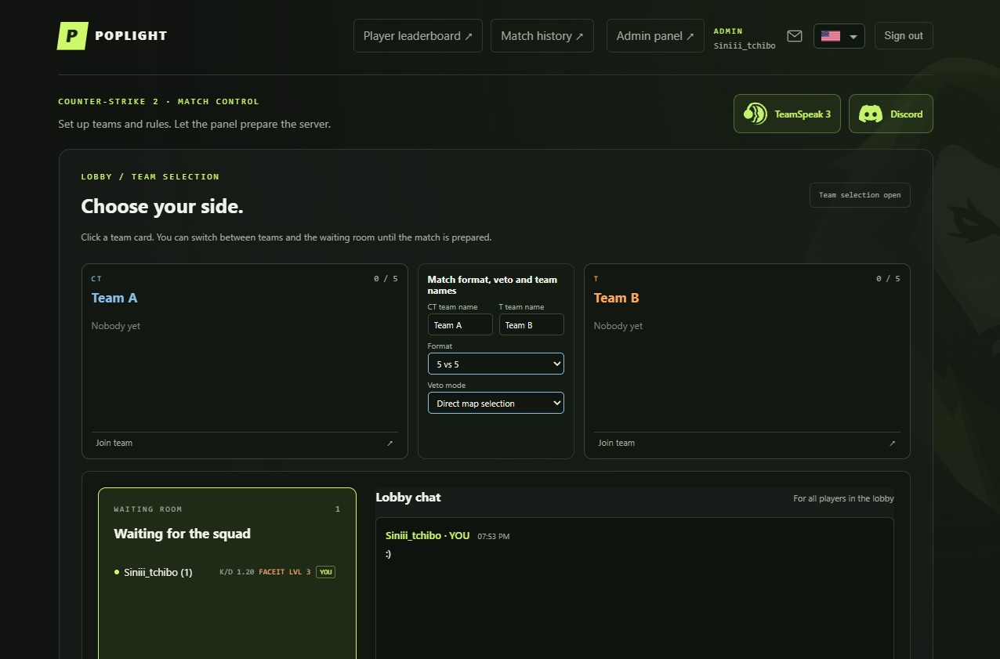

# MatchZy — a customized version 0.9.2 for the PopLight website.

A customized fork of [MatchZy](https://github.com/shobhit-pathak/MatchZy) for **Counter-Strike 2**, developed for use with the **Poplight** project.

> This is an unofficial fork, not an official MatchZy release. The Poplight web application is a separate project and is not included in this repository. (Private for now!)

  

## About Poplight

Poplight is a private CS2 match platform inspired by PopFlash. It combines a web-based lobby, match configuration, and a dedicated CS2 server to make organizing competitive matches with friends easier.

## Changes & Improvements

- **Ready / Unready ClanTag**
- **Demo upload fix**
- **Slovak translation**
- **HUD messages** — adjusted in-game HUD messages.
- **Round backup cleanup** — removes old, unnecessary round backup files.
- **Poplight integration** — plugin-side adjustments for the Poplight platform.
- Other minor fixes and improvements.

## Download & Installation

Download the latest compiled build from [Releases](../../releases). Follow the original MatchZy installation requirements and instructions, then replace the relevant plugin files with this build.

## Credits

This project is based on the original [MatchZy](https://github.com/shobhit-pathak/MatchZy). Credit for the original plugin goes to its authors and contributors.

This fork is an independent customization and is not an official MatchZy release.
